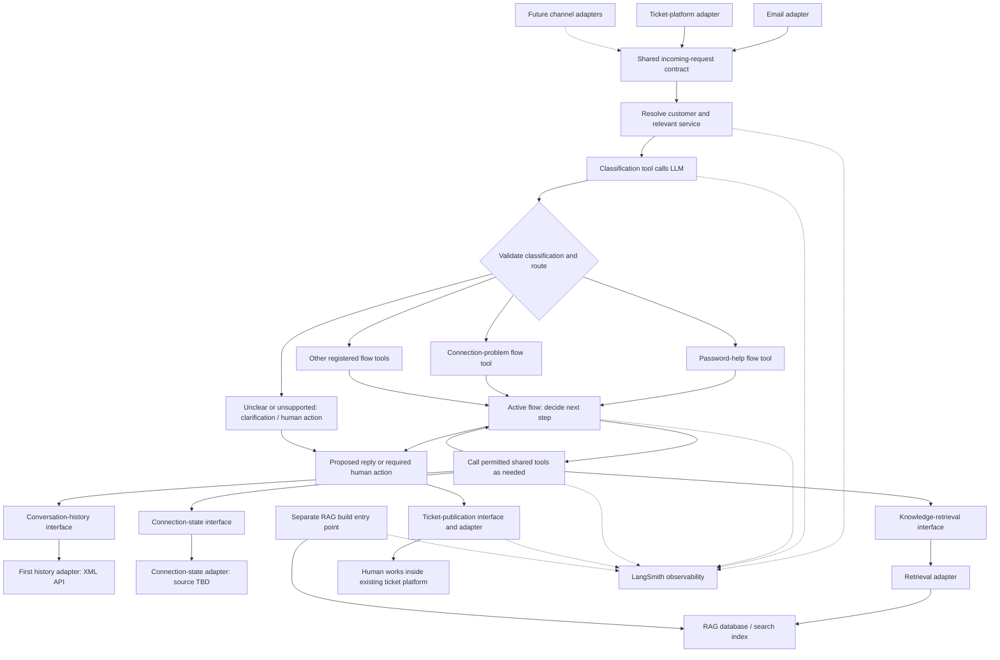

# ISP ticket assistance: architecture and delivery plan

Status: updated scope and proposed interfaces; detailed integration contracts remain open.
Updated: 2026-11-02.

This document describes the intended application independently of the experimental code. Interfaces describe the information and capabilities the workflow needs. Adapters implement those contracts and can be replaced without changing the workflow.

### Current local implementation

The application exports one compiled LangGraph from `src/workflow.ts`. The password
guidance flow is its first implemented branch, with nodes and templates in
`src/branches/password.ts`; additional branches will extend this same graph.
Node functions live separately from the graph definition and are registered
directly, without a workflow-composition factory.

`src/config.ts` loads `.env` and validates required settings and the port before
clients initialize. `src/server.ts` creates the Resend adapter and starts the
Fastify listener. `src/api.ts` receives webhook requests and invokes the workflow;
`src/index.ts` starts the server.

The Resend adapter in `src/adapters/resend.ts` validates inbound events, retrieves
the email, and maps it to `{ id, sender, subject, content }`. The HTTP listener
passes that normalized request to `workflow.invoke({ request }, { context: {
adapter } })`. Execution enters the classification node from `START`. Sending
remains a graph node that calls the run's channel adapter; Resend-specific payloads
and library calls stay in the adapter. A ticket adapter can later supply the same
request shape and reply method once its actual contract is known.

The broader identity, history, connection-state, RAG, and ticket-publication
capabilities below remain planned work. The local milestone retains its existing
password, unrelated-response, and console-only human-handling behavior.

## 1. Known scope

| Area | Known information |
| --- | --- |
| Business | The application assists ticket handling for an internet service provider (ISP). |
| Channels | Support company-hosted email and the existing ticket platform through adapters; allow additional or replacement channels later. |
| Ticket platform | It already converts emails into tickets. Humans review responses and work in that platform, for now. |
| Request context | The model needs message content, sender information and available customer identity data. Extend the shared contract as real fields become known. |
| Customer/service identification | An explicit workflow step resolves available identity hints into customer and relevant service/connection references through an adapter. Customer-specific tools use the resolved references; matching rules and data sources will be completed when known. |
| Conversation history | A separately implemented adapter retrieves previous conversations. The first implementation calls an API returning XML. |
| Connection state | Add a separate adapter/tool for the customer's current internet connection state. Its source and available fields are unknown. |
| Orchestration | Use LangGraph to coordinate independently implemented tools and response preparation. |
| Observability | Use LangSmith to trace and inspect classification, routing, issue flows, tool calls, retrieval and response generation. |
| Classification and routing | After a channel emits a request, a classification capability calls the LLM and returns a structured classification. LangGraph routes the request to the corresponding registered flow. |
| Issue flows | Each issue flow is independently implemented and can be exposed through a flow tool. Password help and connection problems are examples; the actual category list remains open. Each flow uses the tools it needs until it can propose a reply or request human action. |
| Knowledge | Build RAG from the company's tree-structured knowledge base, held in another database. |
| RAG boundaries | Keep knowledge preparation separate from ticket handling, with interfaces and replaceable adapters. Start with a simple standalone build path in this codebase. |
| Deployment | Company infrastructure; probably Kubernetes. The RAG database will probably run in a separate container/workload. These deployment details are tentative. |
| Open scope | Other channels, ticket volume, business/data rules, model selection and automated ticket actions are not defined. |

Humans remain in the ticket platform. Replies, owner changes and similar operations may be suggested; the app's authority to execute them is not yet agreed.

## 2. Big picture: contracts first, adapters behind them



The dependency direction is:

```text
LangGraph: identify customer/service -> classify -> route -> selected flow -> required tools
Tools -> interfaces <- adapter implementations
```

Configuration wires the selected implementations into the interfaces at startup. Transport, authentication, XML parsing and database queries stay inside adapters. The workflow and model receive validated, normalized data.

Channel adapters deliver the initial request. When more channel context is needed, a tool can retrieve it through a shared context interface. The history, connection-state and knowledge capabilities are separate callable tools. Ticket publication uses its own interface at the controlled handoff step.

Customer/service identification is an explicit shared step after intake. Its adapter resolves the available message/ticket identity information using the company's agreed source and matching rules. A resolved customer is required for customer-specific history; connection-state lookup also requires the relevant resolved service/connection reference. The model cannot supply a guessed identity to bypass this step.

The identification step records missing, ambiguous or unavailable results explicitly. Those outcomes can still be classified and use general knowledge, but unresolved customer/service lookups lead to clarification or human action. Customer matching is distinct from authorization to access data or execute an action; the applicable company rules remain to be defined.

The router passes the normalized request and classification into the selected flow; it does not send an email to another mailbox. The shared decision/tool loop in the diagram runs within that active flow. Each flow chooses its own tools and required steps rather than every request always fetching history, knowledge and connection state.

When mailbox and ticket adapters observe the same message, retain source identifiers and correlate them to the existing ticket. Deduplication and ticket matching belong to shared intake handling. The actual correlation mechanism remains unknown.

## 3. Shared interfaces and data contracts

These are starting contracts to agree on, not a claim that every source supplies every field. Add fields when their meaning and availability become known. Missing values stay explicit; adapters must not invent identity or operational facts.

| Contract | Information it should represent |
| --- | --- |
| `IncomingRequest` | Internal request reference, channel/source reference, external message and conversation references, ticket reference when known, message content, subject when available, sender and available identity hints. |
| `IdentityHints` | Available sender address/name and source-provided customer/account/service references, with their source. Hints are not automatically verified customer identity. |
| `IdentityResolution` | Result of the explicit identification step: resolved customer/service references where established, their source, and missing/ambiguous information. The concrete matching evidence and rules remain open. |
| `CustomerLookup` | Resolved customer reference and, where required by the tool, service/subscription reference supplied by the identification step. Missing or ambiguous references remain in the identification outcome and must not become guessed lookup arguments. |
| `ClassificationResult` | Recognized issue/category, routing information, missing information and any indication that the request is ambiguous, unsupported or contains multiple issues. Categories and routing rules are not finalized. |
| `FlowInput` / `FlowOutcome` | Request, classification and available context in; a proposed reply, clarification request or required human action out. Include relevant evidence and unresolved information. |
| `ConversationHistory` | Previous messages with content, speaker/sender and timestamps where available; conversation/source references, retrieval time and whether the result is partial. |
| `ConnectionSnapshot` | State for the identified connection/service, observation time where available, source reference and supported operational facts. Unknown or unavailable state must remain distinguishable from a disconnected connection. |
| `KnowledgeEvidence` | Relevant passages, source node IDs, tree paths and available source/version metadata. |
| `ResponseProposal` | Proposed reply, supporting references, missing information and suggested next steps. Human-facing notes remain distinguishable from customer-facing content. |
| `ToolResult<T>` | A typed result: successful data, not found, ambiguous, unavailable, unauthorized or invalid response, as applicable. A failed lookup must not masquerade as an empty successful result. |

Illustrative signatures show the boundaries; their types and field schemas will be finalized against real samples:

```ts
interface RequestContextPort {
  getContext(request: RequestRef): Promise<ToolResult<IncomingRequest>>;
}

interface IdentityResolutionPort {
  resolve(request: IncomingRequest): Promise<ToolResult<IdentityResolution>>;
}

interface TicketClassificationPort {
  classify(request: IncomingRequest): Promise<ToolResult<ClassificationResult>>;
}

interface IssueFlow {
  run(input: FlowInput): Promise<FlowOutcome>;
}

interface ConversationHistoryPort {
  getHistory(customer: CustomerLookup): Promise<ToolResult<ConversationHistory>>;
}

interface ConnectionStatePort {
  getState(customer: CustomerLookup): Promise<ToolResult<ConnectionSnapshot>>;
}

interface KnowledgeRetrievalPort {
  search(query: KnowledgeQuery): Promise<ToolResult<KnowledgeEvidence[]>>;
}

interface TicketPublicationPort {
  publishProposal(ticket: TicketRef, proposal: ResponseProposal): Promise<PublicationResult>;
}
```

These are application interfaces. The tool layer adds model-facing names, descriptions and input schemas; adapter classes do not need to know about LangGraph. Adapters validate and map source data to these contracts, and application code validates model-generated tool arguments before executing them. Unknown customer/service identity requires a defined resolution path rather than a guessed lookup.

For example, a future JSON history adapter can replace the XML adapter while keeping `ConversationHistoryPort` and the model-facing history tool unchanged. A different email or ticket platform can map its fields to the same request contract.

## 4. Classify, route, then execute the issue flow

The intended sequence is:

```text
Channel emits request
  -> identify customer and relevant service through an adapter
  -> record resolved / missing / ambiguous identity outcome
  -> classification tool/node calls the LLM
  -> validate the structured classification
  -> route to a registered issue-flow tool
  -> selected flow decides what information or step is needed
  -> call history / knowledge / connection-state / other permitted tools
  -> evaluate results and continue within that flow as needed
  -> propose a reply, request clarification, or require human action
  -> publish the result inside the existing ticket platform
```

The classification tool is the wrapper that makes the classification LLM call; these are one logical step. It is invoked at entry by the graph, so the model does not need to decide whether classification should happen. Application routing maps a validated result to a known flow.

A flow coordinates multiple steps and tool calls. It can start as a function and become a LangGraph subgraph when it needs its own branching and state. Exposing it through a flow tool preserves the independently implemented boundary you want. Shared information tools remain reusable across flows. LangGraph supports conditional routing and subgraphs with defined input/output boundaries. [Support-workflow example](https://docs.langchain.com/oss/javascript/langgraph/thinking-in-langgraph), [subgraphs](https://docs.langchain.com/oss/javascript/langgraph/use-subgraphs).

| Tool/capability | Purpose | Implementation boundary |
| --- | --- | --- |
| `resolve_customer_service` | Resolve available identity hints before customer-specific tools are used. | Identity-resolution interface backed by a company-specific adapter; invoked as a required workflow step. Source and matching rules remain unknown. |
| `classify_ticket` | Call the LLM to classify the request into an agreed category or explicit fallback outcome. | Classification interface backed by the selected model adapter; structured result validated before routing. |
| Issue-flow tools | Run the selected password-help, connection-problem or other registered flow. | Common flow input/output contract; each implementation coordinates its own steps and allowed tools. |
| `get_request_context` | Load additional message/ticket context if it was not supplied at intake. | Request-context interface backed by the selected channel adapter. |
| `get_conversation_history` | Retrieve previous customer conversations. | History interface; first adapter calls and parses the XML API. |
| `get_connection_state` | Retrieve current state for the identified ISP service/connection. | Connection-state interface; source implementation remains open. |
| `search_knowledge` | Retrieve relevant company knowledge and process guidance. | Knowledge-retrieval interface backed by the prepared RAG index. |
| Publish proposal | Put assistance into the existing ticket platform. | Publication interface invoked at the workflow's handoff step; exact draft/note mechanism is unknown. |

Proposed runtime flow:

1. A channel adapter emits normalized request data; shared intake resolves ticket linkage and records the processing request.
2. Run customer/service identification through its interface and adapter. Record the outcome and the resolved references available for subsequent tools. Missing or ambiguous identity must not silently select a customer or connection.
3. The classification tool calls the LLM using the message and available context, including the identification outcome. Validate its structured result against the agreed categories.
4. LangGraph routes the result to a registered issue flow. Unclear, unsupported or multiple-issue requests take an explicit fallback path rather than being forced into an arbitrary flow.
5. The selected flow runs its required steps and lets the model choose among its permitted tools where appropriate. It can retrieve knowledge, previous conversations, connection state or other information as needed; no universal retrieval order is assumed. Customer/service-specific tools require the corresponding resolved references.
6. Tool wrappers call their interfaces and receive normalized results. The active flow evaluates the results, continues with another permitted step, or stops when information is missing, a tool fails or a human action is required.
7. End with a proposed reply, a clarification request or an explicit human-action outcome. Validate it and publish it to the corresponding ticket through the publication interface.
8. The human reviews and acts inside the ticket platform. The app can finish its run at publication; any later feedback synchronization is a separate integration decision.

Examples illustrate routing rather than approved company procedures:

- **Password-help request:** classify -> password-help flow -> retrieve the applicable process and any context that process requires -> propose guidance or request human action. Classifying a request as password-related does not itself authorize a password change.
- **Connection problem:** classify -> connection-problem flow -> obtain the relevant history, connection snapshot and troubleshooting guidance as needed -> propose the next response or escalate.

### Points to settle in this design

- **Classification can be uncertain or incomplete.** Include an explicit fallback and a multiple-issue outcome. If later evidence contradicts the category, allow a controlled reroute or human handoff. The category taxonomy and multi-issue handling policy remain open.
- **A flow tool coordinates work.** A complete flow can call several shared tools and contain several model decisions. Keep that internal sequence in its flow implementation/subgraph, with a common input/output contract.
- **Every loop needs an exit.** Bound model/tool calls and retries, and stop on repeated failure or lack of progress. Missing customer information should produce clarification or human action, rather than endless retrieval. Exact budgets remain undecided.
- **Classification selects a process, not permission.** Password changes, owner changes and other mutations require the agreed identity, authorization and company rules. For the current scope, publish proposed replies and required human actions in the ticket platform.

Persist graph progress where recovery is needed. Preserve source timestamps and make repeated publication safe. Graph state should track the request, identity-resolution result, classification, active flow, tool results, remaining execution budget and outcome; it does not replace the ticket platform's business records. LangGraph provides state-based graphs and persistence, while tool definitions expose callable capabilities with schemas. [Graph API](https://docs.langchain.com/oss/javascript/langgraph/graph-api), [persistence](https://docs.langchain.com/oss/javascript/langgraph/persistence), [tools](https://docs.langchain.com/oss/javascript/langchain/tools).

Current connection state is time-sensitive evidence. Previous conversations provide historical context; retrieved company guidance provides process evidence. Keep their sources and timestamps distinct when forming a proposal. Permissions for owner changes or other ticket mutations remain a separate decision from the model's recommendation.

## 5. RAG: separate build path, simple boundaries

The RAG builder can run independently of channel intake, customer history and LangGraph ticket execution. Start with a separate command/entry point in this codebase. It does not need its own web service or complex orchestration.

```text
RAG build path:
Company tree knowledge database
  -> KnowledgeSource interface / adapter
  -> prepare text while preserving tree context
  -> Embedding interface / adapter, if semantic search is selected
  -> KnowledgeIndex writer interface / adapter
  -> RAG database / search index

Ticket-time search:
search_knowledge tool
  -> KnowledgeRetrieval interface / adapter
  -> query the prepared index
  -> return passages and source references
```

| RAG boundary | Responsibility |
| --- | --- |
| Knowledge source | Read nodes, relationships and available metadata from the existing company database. The driver and query implementation stay inside its adapter. |
| Preparation | Preserve node IDs, parent/ancestor paths and useful parent context; produce searchable sections. |
| Embeddings | Provide document/query embeddings behind an interface if used; keep the chosen model and index representation compatible. |
| Index writer | Store prepared content and metadata; refresh or rebuild when source content changes. |
| Retrieval | Search the index and return normalized evidence without exposing database-specific results to the workflow. |

The source knowledge database remains authoritative. The RAG database holds derived searchable content; the two have different roles. Updating, moving or deleting a source node must eventually update the index, using a refresh strategy selected when the source capabilities are known. Begin with a straightforward build/rebuild process and representative retrieval examples.

Tree structure alone does not establish the database engine, node fields, languages or permissions. Keep those details open behind the interfaces.

## 6. Tools and libraries

LangGraph is selected for orchestration and LangSmith for observability. The other choices below are proposals unless confirmed. No dependencies are changed by this document.

| Concern | Choice / candidate | Role |
| --- | --- | --- |
| Backend | TypeScript, Node.js LTS, pnpm | Proposed continuation of the repository tooling. |
| Workflow | `@langchain/langgraph` | Selected orchestration for classification, routing, issue flows/subgraphs, shared tools and proposal generation. [Docs](https://docs.langchain.com/oss/javascript/langgraph/graph-api) |
| Observability | LangSmith, with the `langsmith` SDK where custom instrumentation is needed | Selected tracing for LangGraph runs, flow/subgraph execution, model calls and tools; instrument custom adapter and RAG operations where needed. [Overview](https://docs.langchain.com/langsmith/observability), [LangGraph tracing](https://docs.langchain.com/langsmith/trace-with-langgraph) |
| Tool/model contracts | LangChain tool definitions and compatible model integration | Define model-callable capabilities and schemas; select the model integration after provider choice. [Tools](https://docs.langchain.com/oss/javascript/langchain/tools) |
| Validation | `zod` | Candidate for shared data contracts, tool arguments and structured proposals. [Docs](https://zod.dev/) |
| Intake endpoints | `fastify`, where HTTP endpoints are needed | Candidate for ticket webhooks/internal endpoints. [Docs](https://fastify.dev/docs/latest/Reference/Validation-and-Serialization/) |
| API calls | Node.js `fetch` / `AbortSignal` | Candidate for HTTP calls inside adapters. [Docs](https://nodejs.org/api/globals.html#fetch) |
| First history adapter | `fast-xml-parser` | Candidate for XML parsing and mapping; SOAP remains unknown. [Repository](https://github.com/NaturalIntelligence/fast-xml-parser) |
| Mailbox adapter | `imapflow` / `mailparser`, if supported | Candidates for IMAP and MIME access; the shared interface does not depend on that protocol. [ImapFlow](https://imapflow.com/), [MailParser](https://nodemailer.com/extras/mailparser) |
| RAG storage | PostgreSQL full-text search + `pgvector` | Candidate derived index, behind index/retrieval interfaces; not a decision about the source database. [Full-text search](https://www.postgresql.org/docs/current/textsearch-intro.html), [pgvector](https://github.com/pgvector/pgvector) |
| App persistence | PostgreSQL/`pg` and a compatible LangGraph checkpointer | Candidates for processing/publication records and durable graph state; distinct responsibilities from the RAG index. [pg](https://node-postgres.com/), [checkpointing](https://docs.langchain.com/oss/javascript/langgraph/add-memory) |
| Jobs, if needed | `pg-boss` if PostgreSQL is selected | Candidate for background dispatch and retries; choose after intake/runtime requirements are known. [Repository](https://github.com/timgit/pg-boss) |
| Generation/embeddings | Undecided model clients behind interfaces | Selection depends on company data rules, language needs and model availability. |
| Verification | `vitest` | Candidate for adapter contract tests, workflow checks and retrieval/response evaluation. [Docs](https://vitest.dev/guide/) |

The connection-state client, knowledge source driver and ticket SDK remain adapter implementation choices. They do not block agreeing on normalized contracts and using fixture adapters first.

### LangSmith observability

Attach tracing to execution from the first fixture-backed workflow. Correlate each processing run with its internal request/ticket reference and graph thread, then record child runs for identity resolution, classification, the selected flow, tool/adapter calls, retrieval, generation and publication. Record routing outcomes as metadata so the selected flow can be inspected alongside its classification result. LangGraph integration supplies graph/model tracing; custom operations may need explicit instrumentation. [Tracing guide](https://docs.langchain.com/langsmith/trace-with-langgraph).

Track latency, errors, retries, fallback/human-action outcomes and token usage or cost where available from the selected model integration. Trace the independent RAG builder separately, recording build/index versions so retrieval and proposals can be related to the knowledge version used.

Keep tracing setup in shared observability/configuration code. LangSmith records execution alongside the workflow; it is not a model-selected business tool or the owner of graph state. Retain application/container logs for operational diagnosis.

LangSmith hosting/endpoint, access, retention and trace-content rules remain undecided. Configure masking or input/output exclusion before tracing real customer content, and keep credentials out of traces. LangSmith supports hiding or transforming trace data before upload. [Trace-data controls](https://docs.langchain.com/langsmith/mask-inputs-outputs).

## 7. Deployment direction

**Probable layout, not a finalized deployment design:**

```text
Company infrastructure / probable Kubernetes environment
  - App runtime workload: channel intake + LangGraph + tools
  - RAG build job/command: same codebase, independent execution
  - RAG database/index: separate database workload/container, probably
  - Durable app/checkpoint storage: selected separately
  - LangSmith observability endpoint: hosting/location TBD
  - Existing ticket, email, history, connection and knowledge systems
```

If Kubernetes is confirmed, a Deployment can host the running app and a Job can run a finite RAG build. The app and builder can share an image with different entry commands. Database access should use a configured endpoint; the retrieval interface does not depend on container placement. [Deployments](https://kubernetes.io/docs/concepts/workloads/controllers/deployment/), [Jobs](https://kubernetes.io/docs/concepts/workloads/controllers/job/), [Services](https://kubernetes.io/docs/concepts/services-networking/service/).

Container placement and durable database storage are separate decisions. Persistence, backups, access and operating responsibility need to be defined with the company's infrastructure team. Model inference location is also still unknown.

## 8. Suggested source structure

```text
src/
  contracts/                  # Normalized data schemas
  ports/                      # Interfaces for replaceable capabilities
  adapters/
    channels/                 # Email, ticketing and future adapters
    identity/                 # Customer and service resolution; source/rules TBD
    history/                  # First implementation: XML conversations API
    connection-state/         # ISP connection-state implementation
    knowledge-source/         # Existing tree database connector
    knowledge-index/          # Index writer and retrieval implementations
    models/                   # Generation and embedding clients
    ticket-publication/       # Publish proposals to the existing platform
  tools/                      # Classification, shared tools and flow wrappers
  workflow/                   # Main LangGraph state, classification and routing
  flows/                      # Independent issue workflows/functions/subgraphs
    password-help/            # Illustrative flow; company process TBD
    connection-problem/       # Illustrative flow; company process TBD
  rag/                        # Simple build/preparation and retrieval logic
  entrypoints/
    app.ts                    # Intake and ticket-assistance runtime
    build-rag.ts              # Independently runnable RAG build
  config/                     # Select and wire adapter implementations
  persistence/                # Processing records and checkpoint integration
  observability/              # LangSmith tracing, correlation and trace-data controls
tests/                        # Contract fixtures and integration/evaluation checks
```

This is a proposed layout, not implemented source. Keep interfaces framework-independent and wire concrete dependencies at the entry points.

## 9. Starting point and delivery steps

| Step | Work | Result |
| --- | --- | --- |
| 1. Agree on contracts | Define request, identity-resolution outcome, classification, flow input/outcome, history, connection, knowledge and proposal shapes. Agree on initial categories, route mapping and fallback behavior. | Stable starting boundaries with explicit unknowns. |
| 2. Implement fixture adapters and tools | Supply representative input/results behind each interface. | Tools can be developed and checked independently of live systems. |
| 3. Build the LangGraph path | Wire identity resolution -> classification -> validated routing -> one representative issue flow -> required tools -> reply/clarification/human-action outcome. Enable LangSmith tracing and add other flows behind the same contract. | End-to-end assistance with inspectable runs, independently implemented flows and replaceable adapters. |
| 4. Build RAG independently | Add the source adapter, tree-aware preparation and index writer; verify retrieval on sample questions. | A standalone builder and a usable knowledge-retrieval adapter. |
| 5. Replace fixtures with live adapters | Implement ticket/email intake, customer/service identification, XML history, connection state and ticket publication as their contracts become available. | Live integrations without rewriting the shared workflow. |
| 6. Deploy and verify | Containerize runtime and builder; confirm Kubernetes/database layout and LangSmith configuration; check recovery, trace-data controls, correlation and publication behavior. | Usable assistance in the existing ticket platform with operational visibility. |

Steps 3 and 4 can progress independently after the retrieval contract is agreed. Steps 4 and 5 depend on the relevant real system details, not on inventing them now.

**Starting point:** agree on the interface/data contracts and initial classification-to-flow mapping, then build fixture-backed tools and one representative issue flow. In parallel, define the small standalone RAG builder around source and index interfaces.

**Final state:** a channel emits a normalized request; the identification step resolves available customer/service references; an LLM-backed classification step routes it to the corresponding issue flow; that flow uses permitted history, connection-state, knowledge and other tools until it can propose a reply or identify required human action. Results reach humans in the existing ticket platform. Adapters and flows remain independently replaceable. RAG preparation runs separately and writes to its configured database/index. Deployment can follow the probable Kubernetes layout once confirmed.

## 10. Agreed follow-up work for later phases

The following review findings are accepted design work. Add their detailed behavior incrementally in the next phases as company rules, real payloads and integration capabilities become available. They do not require inventing those details now or completing every item before fixture-based development can begin.

Customer/service identification is already part of the baseline workflow above. Its real matching rules and source adapter will be completed when the relevant data is known.

| Follow-up area | Work to add when the inputs are available | Dependency / evidence needed |
| --- | --- | --- |
| Meaning of the knowledge tree | Establish whether nodes organize articles, encode decision branches, or contain both. Preserve and execute required process conditions explicitly where applicable; retrieval alone must not skip them. | Representative nodes/paths and an explanation from the knowledge/process owner. |
| Revisable classification | Define multiple-issue handling, fallback behavior and controlled rerouting when later evidence contradicts the initial category. | Agreed categories, representative tickets and routing rules. |
| Conversation lifecycle | Define how new customer messages affect active runs and proposals; track input revisions, prevent stale publication, correlate overlapping inputs and avoid processing the app's own publications as new customer requests. | Ticket event semantics, message identifiers and update/publication capabilities. |
| Flow rules and outcomes | Specify mandatory checks, tool/action permissions, retry/execution limits and when each flow replies, requests clarification, hands off to a human or fails. | Approved company procedures, authorization rules and operational targets. |
| Quality evaluation | Build reviewed ISP examples and expected classifications, relevant knowledge and acceptable responses. Evaluate routing, retrieval and response quality separately alongside LangSmith tracing. | Redacted tickets, source knowledge and domain-review criteria; acceptance targets remain open. |
| Ticket handoff | Verify and implement the supported draft, note or other assistance format and its relationship to human work. | Actual ticket-platform integration contract and publication behavior. |
| Model and trace-data handling | Agree model inference location, LangSmith hosting/endpoint, allowed content, masking, access and retention before using real customer content in those integrations. | Company data policy and infrastructure decisions. |

Use fixture adapters and explicit unresolved outcomes until the relevant details are available. Replace each placeholder with agreed behavior as its phase is implemented.

## 11. Details still open

- Actual channel transport, ticket matching/publication capabilities and available identity fields.
- Customer/service resolution source, matching evidence, ambiguity handling and applicable access rules.
- XML history schema/authentication and customer/service lookup identifiers.
- Source and meaning of available connection-state data.
- Tree knowledge schema, database engine, language, update/access rules and index/model selection.
- Company business/data rules and permitted automated ticket actions.
- Classification categories, issue-flow definitions, multiple-issue/fallback policy and execution budgets.
- Ticket volume, model inference location, final Kubernetes layout and database operating choices.
- LangSmith hosting/endpoint, access, trace-content policy, retention and sampling.

These can remain open at this stage. The interfaces provide the boundaries for progressing without assuming provider implementations.
